# KX Game Studios brand kit

Everything needed to build a website (or anything else) in the KX Game Studios brand. If you are an AI agent: read this file first, then `BRAND.md`, then use `tokens.css` and the files in `assets/`. Do not redraw, retype or regenerate the logo; always use the supplied files.

## What KX Game Studios is

A two-person game studio run by Alek and Alex. The names differ by one letter, K and X. The logo interlocks those letters as two folded ribbons around a cut gem. Tagline: "Two players, one studio." No games, release dates, team bios, contact details or social links are defined in this kit; ask the owner rather than inventing them. `example/index.html` uses placeholders.

## Contents

| Path | What it is |
| --- | --- |
| `README.md` | This guide. |
| `BRAND.md` | The brand book: logo rules, colour, type, shape, voice. |
| `tokens.css` | CSS custom properties and type classes. Link this in every page. |
| `tokens.json` | The same tokens as data, with a usage note on each. Source of truth. |
| `assets/logos/` | Logo SVGs. `png/` holds 1200px-wide transparent PNG copies. |
| `assets/icons/` | Favicons and app icons. |
| `assets/graphics/` | Tileable lattices and gem patterns, social banner (1500 x 500), Open Graph image (1200 x 630). |
| `example/index.html` | A working starter page that uses all of the above. |

## Quick start

```html
<html lang="en" data-theme="dark">
<head>
  <link rel="stylesheet" href="tokens.css">
  <link rel="icon" href="assets/icons/favicon.svg" type="image/svg+xml">
  <link rel="icon" href="assets/icons/kx-app-icon-32.png" sizes="32x32" type="image/png">
  <link rel="apple-touch-icon" href="assets/icons/apple-touch-icon.png">
  <meta name="theme-color" content="#120a24">
  <meta property="og:image" content="https://YOUR-DOMAIN/assets/graphics/og-image.png">
</head>
<body style="background:var(--bg);color:var(--ink);font-family:var(--font-body)">
  
</body>
```

`tokens.css` imports Chakra Petch (600, 700) and DM Sans (400, 500) from Google Fonts. To self-host, download both families (SIL Open Font License), remove the `@import` line and add your own `@font-face` rules.

Dark is the default theme. Set `data-theme="light"` on `<html>` for the light theme; only the neutral and `-text` tokens change.

## Which logo file to use

| Situation | File |
| --- | --- |
| Site header on dark or purple ground | `kx-logo-horizontal-on-dark.svg` |
| Site header on white or light ground | `kx-logo-horizontal.svg` |
| Hero, splash, centred layouts (dark / light) | `kx-logo-stacked-on-dark.svg` / `kx-logo-stacked.svg` |
| Mark alone (dark / light) | `kx-mark-on-dark.svg` / `kx-mark.svg` |
| Avatar, badge, social profile picture | `kx-emblem.svg` (purple) or `kx-emblem-dark.svg` |
| Favicon, bullets, loaders, anything under 48px | `kx-gem.svg` |
| On photos or one-colour print | `kx-mark-mono-white.svg` / `kx-mark-mono-black.svg` |
| Name only, mark already nearby | `kx-wordmark-white.svg` / `kx-wordmark.svg` |
| App stores, PWA manifest | `assets/icons/kx-app-icon-512.png`, `-192.png` |

Logo rules: keep clear space equal to the width of the K stem; minimum width 48px for the mark and 140px for the stacked logo; never recolour, outline, rotate, stretch, add glows or gradients. The wordmark is custom lettering, not a font, so it cannot be typed.

## Colour tokens

| Token | Dark | Light | Use |
| --- | --- | --- | --- |
| `--bg` | #120a24 | #ffffff | Page ground |
| `--surface` | #1c1236 | #f5f2fa | Cards, panels |
| `--ink` | #ffffff | #0e0b14 | Main text |
| `--muted` | #a8a0b8 | #5f5870 | Secondary text |
| `--line` | #2a1f4a | #ddd6ea | Borders, dividers |
| `--purple` | #6c2bd9 | same | Primary fills, primary buttons |
| `--purple-shade` | #4a1ba3 | same | Hover/pressed purple |
| `--purple-light` | #cdbcf5 | same | Decorative, on dark only |
| `--purple-text` | #b794ff | #6c2bd9 | Links, small purple text |
| `--purple-deep` | #2a0f5c | same | Hero grounds |
| `--purple-tint` | #2a1a4d | #ede5ff | Selected rows, highlights |
| `--gem` | #2fe0d2 | same | Accent fills, the one main call to action |
| `--gem-light` | #7ff0e8 | same | Hover on gem |
| `--gem-deep` | #0f9c94 | same | Pressed on gem |
| `--gem-text` | #2fe0d2 | #0b7f7a | Small accent text |
| `--black` / `--white` | #0e0b14 / #ffffff | same | Fixed black and white |

Rules that keep text readable:

- Text on `--purple` or `--purple-deep` is `--white`.
- Text on `--gem` is `--black`, never white.
- Never use `--purple` or `--gem` directly for small text; use `--purple-text` and `--gem-text`.
- Balance: about 60% dark ground, 30% purple, 10% gem. One `--gem` button per view.
- Do not introduce orange, lime or other new hues. No gradients.

## Type

| Class | Font | Size / line | Weight | Use |
| --- | --- | --- | --- | --- |
| `.display` | Chakra Petch | 64px / 0.95 | 700 | Hero titles |
| `.h1` | Chakra Petch | 40px / 1.1 | 700 | Page titles |
| `.h2` | Chakra Petch | 28px / 1.15 | 600 | Section headings |
| `.label` | Chakra Petch | 12px / 16px, 0.08em, uppercase | 600 | Buttons, nav, tags |
| `.lead` | DM Sans | 20px / 30px | 400 | Intro paragraphs |
| `.body` | DM Sans | 16px / 24px | 400 | Running text |
| `.small` | DM Sans | 13px / 18px | 400 | Captions |

Titles are sentence case. Scale `.display` down on narrow screens (40px works on phones).

## Spacing, shape, components

- Spacing: `--space-1` 4px, `--space-2` 8px, `--space-4` 16px, `--space-6` 24px, `--space-12` 48px.
- Radius: `--radius-none` 0 (default), `--radius-sm` 2px (inputs), `--radius-md` 6px (cards, the maximum). No pills, no circles.
- Signature shape: 45 degree cut corners. For buttons, cut the top-left and bottom-right corners by 8px with `clip-path: polygon(8px 0, 100% 0, 100% calc(100% - 8px), calc(100% - 8px) 100%, 0 100%, 0 8px)`.
- Buttons: primary is `--purple` with white `.label` text; accent is `--gem` with black `.label` text. See `example/index.html`.
- Cards: `--surface` ground, 1px `--line` border, `--radius-md`, `--space-6` padding.
- Borders, not shadows. No glows, no drop shadows.
- Pattern: two kinds, both tiling at their natural 384px as a repeating `background-image`. `kx-lattice-dark.svg` / `kx-lattice-purple.svg` are lines only and are safe behind hero headings and buttons. `kx-pattern-dark.svg` / `kx-pattern-purple.svg` add gems and sparkles and are for empty areas only (footers, dividers, loading screens), never behind text.
- Use `kx-gem.svg` as the bullet or status marker instead of emoji or generic icons.

## Voice

Short and direct, like good tutorial text. Say what the game is and what the player does. No hype words ("epic", "groundbreaking"), at most one exclamation mark per page.

## Accessibility

Every pairing above passes WCAG AA (4.5:1 for text) when used as stated. Give the logo `alt="KX Game Studios"`; decorative gems and patterns get `alt=""`.
